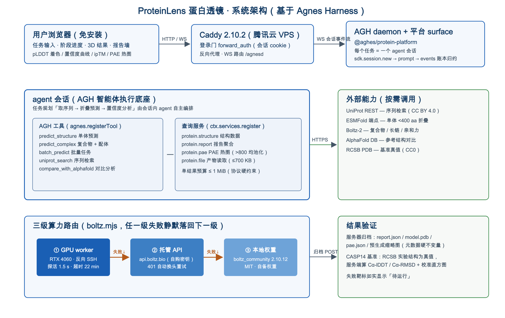
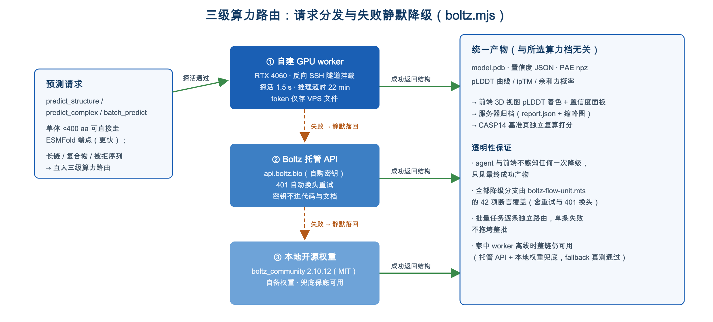
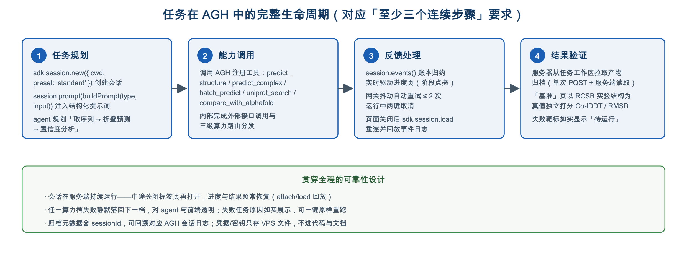
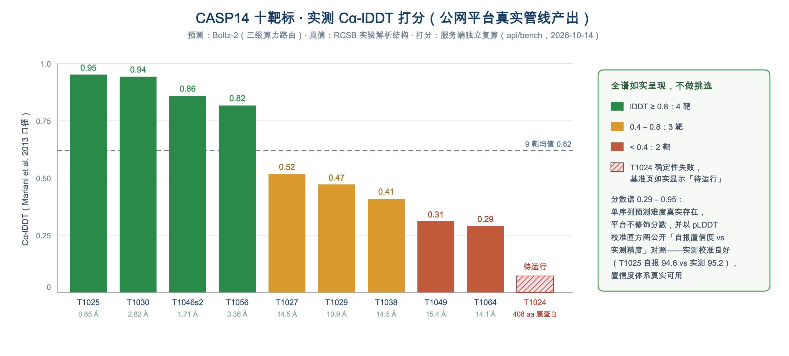

# 项目说明

## 基本信息

- **项目名称**：蛋白质结构预测平台——基于 Agnes Harness 的智能体结构生物学工作台
- **参赛组别**：本科生组
- **学校与专业**：南京大学（人工智能学院 / 医学院）
- **团队成员**：周游（南京大学 医学院，本科大四）；王宏博（南京大学 人工智能学院，本科生 2023 级，大四）
- **问题来源**：蛋白质结构预测工具（AlphaFold、ColabFold、Boltz-2 等）对非生物信息学用户门槛很高：需要命令行、Python/GPU 环境、多工具手动拼装；更关键的是，产出一个 PDB 文件不等于可用——预测质量参差，而普通用户缺乏判断"这次预测可不可信"的能力。本项目把"预测"与"置信度验证"做成一个浏览器即开即用的整体。
- **项目目标**：
  1. 三种输入（UniProt ID / 原始序列 / FASTA）实时识别，三种任务（单体预测、复合物预测、批量预测）一键提交；
  2. 每个结果自带置信度体系（pLDDT 着色、置信度曲线、分段统计、复合物 ipTM 与 PAE 热图），让非专业用户能判断可信度；
  3. 平台自身接受外部学术基准检验（CASP14 十靶标，Cα-lDDT / Cα-RMSD 打分 + pLDDT 校准直方图）；
  4. 历史归档、对比分析、可分享的自包含 HTML 报告。

## 核心方法

以 Agnes Harness（AGH）为智能体执行底座：每个任务 = 一个 AGH agent 会话，由会话内 agent 规划并调用注册在 AGH 工具/服务体系中的预测能力，平台对会话事件流做账本式归约驱动进度呈现，最后由服务器端归档与基准打分完成结果验证。

*图 1 · 系统架构总览：从浏览器到 agent 会话、外部能力与结果验证的完整数据通路*

**算力路由**是核心工程方法之一：预测请求按「自建 GPU worker（RTX 4060，经反向 SSH 隧道挂载）→ Boltz 托管 API（自购）→ 本地开源权重（boltz_community）」三级分发，任一级失败静默落回下一级，对上层 agent 与前端完全透明。

*图 2 · 三级算力路由：请求分发、失败静默降级与算力档无关的统一产物*

## Agnes Harness 执行流程（对应"至少三个连续步骤"要求）

每个任务在 AGH 中的完整生命周期（`orchestrator.ts`）：

1. **任务规划**：`sdk.session.new({ cwd, preset: 'standard' })` 创建会话（orchestrator.ts:381），`session.prompt(buildPrompt(type, input))` 注入按任务类型生成的结构化提示词，agent 在会话内规划「取序列 → 折叠预测 → 置信度分析」的执行顺序；
2. **能力调用**：agent 调用通过 `agnes.registerTool` 注册的 AGH 工具（`predict_structure` / `predict_complex` / `batch_predict` / `uniprot_search` / `compare_with_alphafold`）与 `ctx.services.register` 注册的查询服务（`protein.structure` / `protein.report` / `protein.pae` / `protein.file`），工具内部再完成外部模型/数据接口调用与三级算力路由；
3. **反馈处理**：orchestrator 对 `session.events()` 做账本归约（工具开启/结果关闭）实时驱动进度页；网关抖动自动重试最多两次；运行中可两键取消；页面关闭后 `sdk.session.load`（orchestrator.ts:538）重连并回放事件日志；
4. **结果验证**：任务完成后服务器从任务工作区拉取产物归档（单次 POST + 服务端读取，含元数据硬不变量）；「基准」页以 RCSB 实验结构为真值做 Cα-lDDT / Cα-RMSD 独立打分，失败靶标如实显示"待运行"。

*图 3 · 任务在 AGH 中的完整生命周期：任务规划 → 能力调用 → 反馈处理 → 结果验证*

## 所用模型的名称、版本、使用环节、调用方式与验证方法

| 模型/服务 | 版本 | 使用环节 | 调用方式 | 验证方法 |
| --- | --- | --- | --- | --- |
| ESMFold | v1（ESM Metagenomic Atlas 公共折叠端点） | 单体与批量结构预测（`batch_predict` 逐条复用本工具；短链优先，约 <400 aa；>1000 aa 工具直接拒绝） | HTTPS POST `api.esmatlas.com/foldSequence/v1/pdb/`，经 AGH 工具 `predict_structure`；端点拒绝长链（HTTP 413）时失败信息指路 Boltz-2 档 | pLDDT 曲线 + 与 AlphaFold DB 参考结构 RMSD 对比 + CASP14 基准 |
| Boltz-2 | boltz_community 2.10.12（MIT，本地权重）+ 自购托管 API（备用） | 复合物预测（多链 + 配体）与 400+ aa 长链回退（ESMFold 端点对长链返回 HTTP 413 后按设计路由的档位，CASP14 十靶中仅 T1024 走此档） | AGH 工具 `predict_complex`，内部按三级算力路由分发；产物含 PDB + PAE npz + 置信度 JSON | ipTM / ligand-iPTM /亲和力概率 + PAE 热图 + 与平台基准打分一致性 |
| AlphaFold DB 预测结构 | DeepMind 数据库（CC BY 4.0） | 单体结果与参考预测的对比分析 | AGH 工具 `compare_with_alphafold`，Horn 四元数最优叠合算 Cα-RMSD | 核心区 Cα-RMSD < 2 Å 判定"与参考高度一致"；Jacobi 特征分解处理退化情形 |

**平台级验证**：CASP14 公开靶集在公网平台走真实管线（十靶标，106–408 aa：九靶经 ESMFold 单体档、408 aa 长链经 Boltz-2 档），参考答案取 RCSB 实验解析结构，服务端计算 Cα-lDDT（Mariani et al. 2013 口径）与 Cα-RMSD，并输出 pLDDT 校准直方图。九个靶标完成自动打分，成绩头部突出：lDDT ≥ 0.8 共 4 靶——T1025 达 **0.952 / RMSD 0.65 Å**、T1030 0.943、T1046s2 0.859、T1056 0.817；0.4–0.8 共 3 靶，<0.4 共 2 靶；分数谱 0.29–0.95 全谱如实呈现、不做挑选——单序列预测难度真实存在，平台不修饰分数。校准直方图公开「自报 pLDDT vs 实测 lDDT」对照：实测校准良好（T1025 自报 94.6 vs 实测 95.2，T1046s2 自报 85.0 vs 实测 85.9），置信度体系真实可用而非装饰。作为独立参考精度锚点：血红蛋白 α（P69905）预测与 AlphaFold DB 参考结构核心区 Cα-RMSD **0.31 Å**。长链档靶标的完整运行记录与折叠证据见《运行与验证证据》。

*图 4 · CASP14 实测 Cα-lDDT 打分（公网平台真实管线产出，api/bench 2026-10-14）：分数谱 0.29–0.95 全谱呈现，最高 T1025 0.952 / RMSD 0.65 Å；逐靶分数与复核方式见《运行与验证证据》*

## 质量保障

- 单元探针 77 项断言（归档装配 13、打分数学 22、预测流全生命周期 42）全部通过；typecheck 与 lint 干净；
- 公网端到端探针（登录 → 提交 → 归档 → 重建结果页）真测通过；
- 正常 / 边界 / 失败三类测试样例与复现命令见《运行与验证证据》。
