# @aghes/protein-view

Interactive toolview panels for protein-predictor results: 3D backbone with
pLDDT / rainbow / chain / interface coloring, confidence curve, sequence strip,
PAE error heatmap, compare overlay, batch table, and search results — each
figure carries its own legend and exports (PNG / CSV / clipboard) so it reads
standalone in papers and slides.

## Screenshots

| 单蛋白预测 + 置信度 | 预测 vs AlphaFold DB 对比 |
|---|---|
| 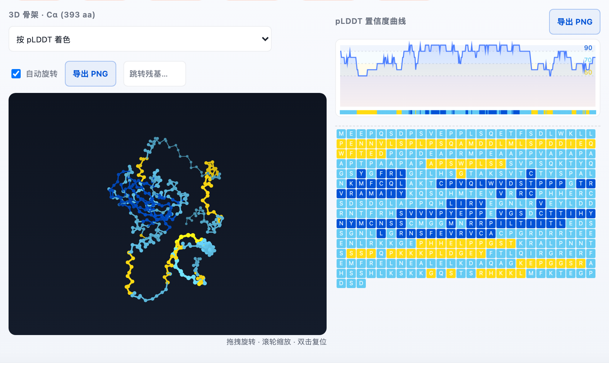 | 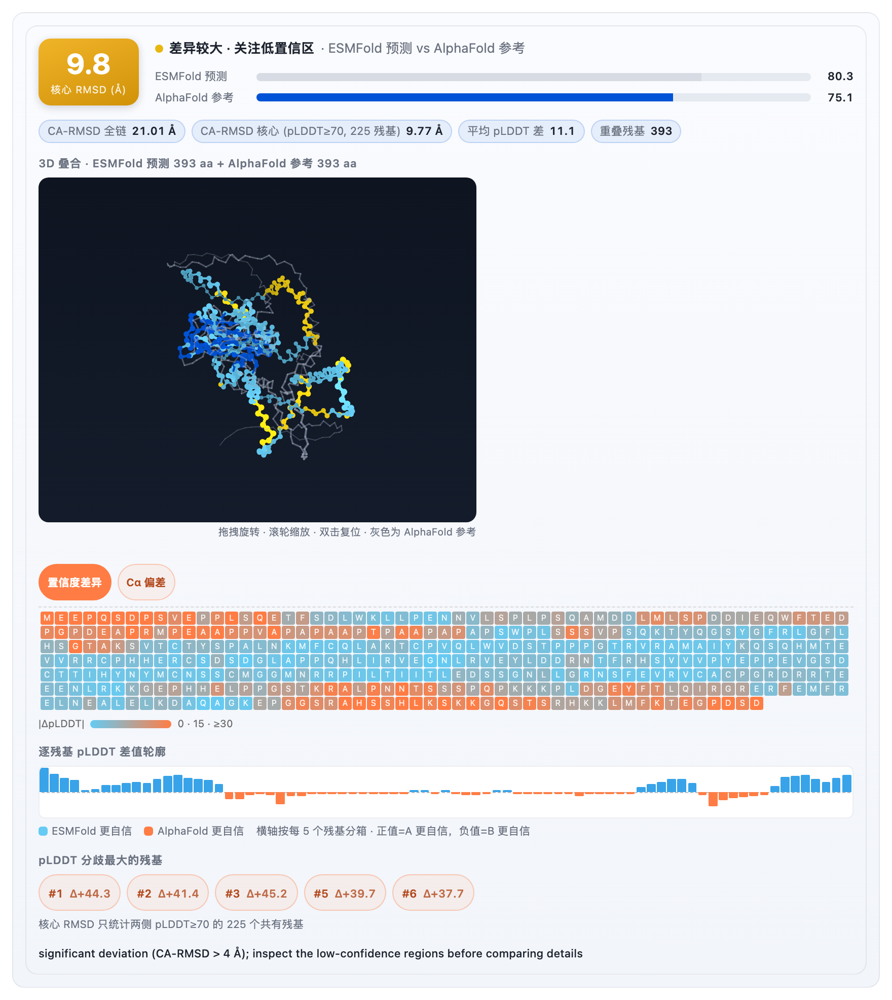 |

批处理与搜索结果卡片；Cα 偏差透镜下的对比面板（3D ghost 与序列条按叠合后 Cα 距离重着色）：

| 多蛋白批处理 | UniProt 搜索 |
|---|---|
| 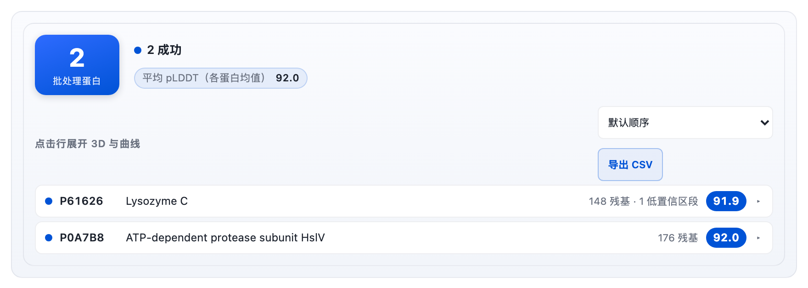 | 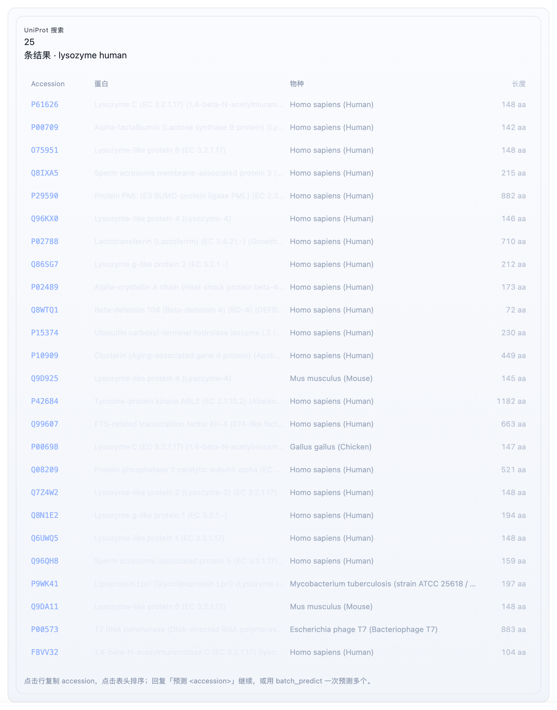 |

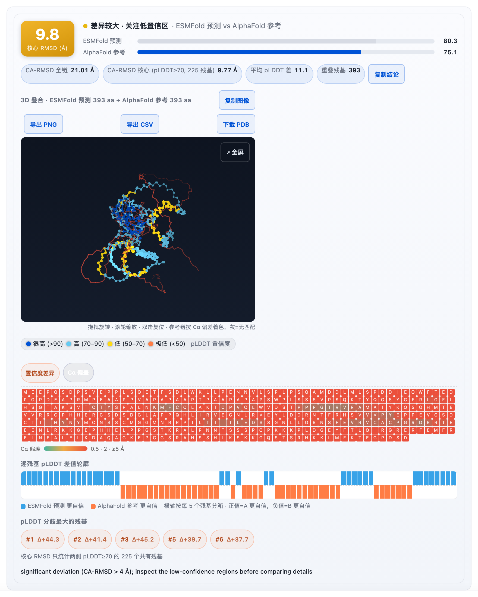

区段聚焦（低置信 chip / 跳转框 `36-42` / 序列条拖选三路驱动同一机制）：
曲线画出橙色区段带，3D 中段外残基淡化为灰——可信与存疑的折叠在空间上直接分开：

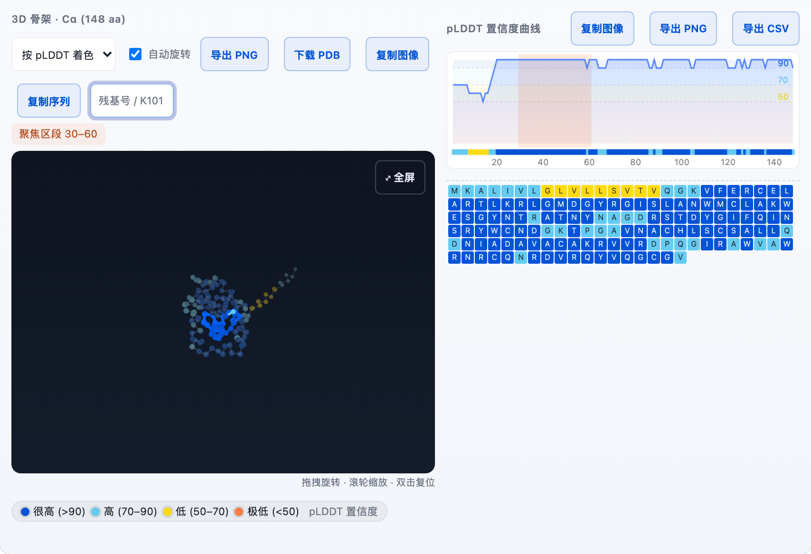

对比卡的分歧序列条同样支持拖选聚焦：拖过的区段让预测 3D 段外残基淡化
（参考 ghost 保留作上下文），分歧区段的折叠差异一眼可读：

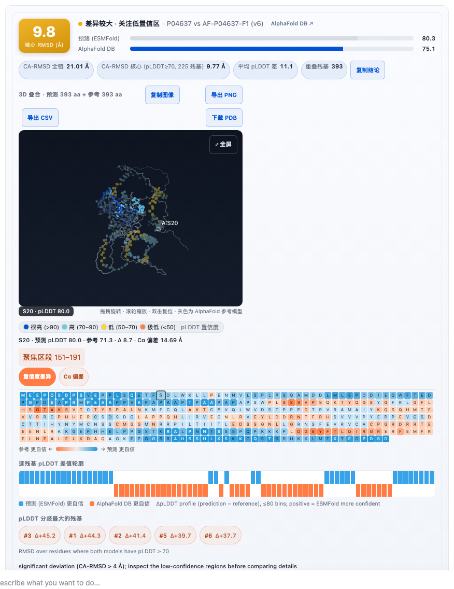

复合物面板的 PAE 误差热图：链边界虚线、链对均值芯片（点击框出该链对的两个
对称误差块，低值 = 界面可信）、悬停十字线联动 3D，点击任意格以琥珀虚线固定
读数——移开鼠标不消失，对着 3D 讲解界面残基对时用；右侧误差条逐残基标出
平均误差（长条 = 界面残基或无序区）：

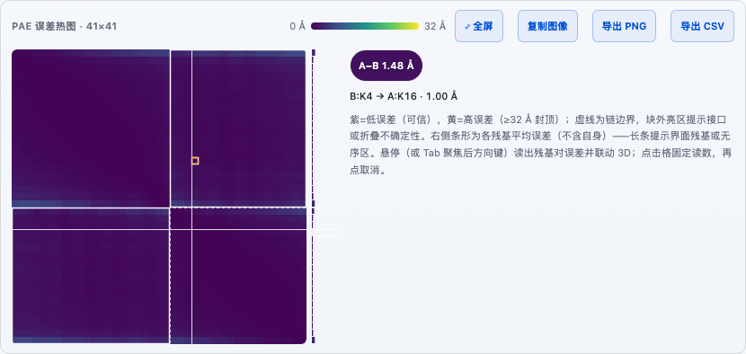

序列条支持键盘导航（Tab 聚焦，←/→ 移动光标、回车选中、Home/End 跳转、Esc 退出），
光标复用悬停高亮——鼠标与键盘共享同一套 3D/曲线联动；对比卡的分歧序列条复用同一组件，
键盘行为一致；搜索表与批处理表同样可键盘操作（↑↓/Home/End 行间移动，空格勾选/展开，
回车复制或下钻），搜索表排序表头是原生按钮（Tab+回车排序）。PAE 热图 Tab 聚焦后
方向键移动读出格（白框标出当前格，读数与 3D 联动，Esc 退出）；点击格（或聚焦后
按 Enter）以琥珀虚线框固定读数——移开鼠标或失焦后读数不消失，再点/再按取消。
面板内所有可交互元素
均可由鼠标与键盘双通道操作。
3D 视图用 Pointer Events 驱动：桌面拖拽旋转 / 滚轮缩放 / 双击复位，触屏上
单指拖转、双指捏合缩放、双击复位（第二根手指按下即切换到手势缩放，松开后
需重新触摸才会旋转；异常释放的触摸会被安全复位，不会卡死手势）。置信度曲线
同样走 Pointer Events：触屏横向滑动即可 scrub 十字线读数（`touch-action: pan-y`
保留纵向页面滚动）。
3D 自动旋转可用工具栏开关暂停，且默认尊重系统「减少动态」（prefers-reduced-motion）
设置——要求减少动态的环境下结构不自转，手动勾选可恢复。

深色模式（跟随宿主 system/light/dark 设置；canvas 图表保留白底「论文图卡」风格，导出 PNG 跨主题逐字节一致）：

| 单蛋白（深色） | 对比（深色） |
|---|---|
| 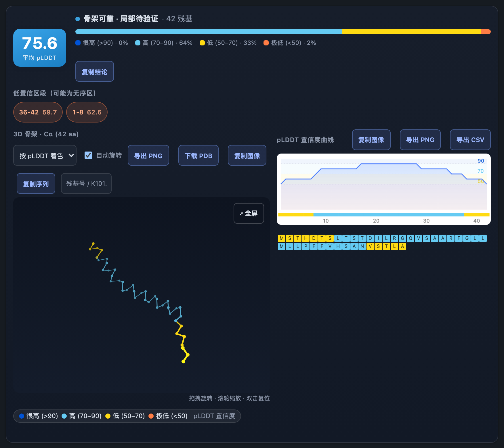 | 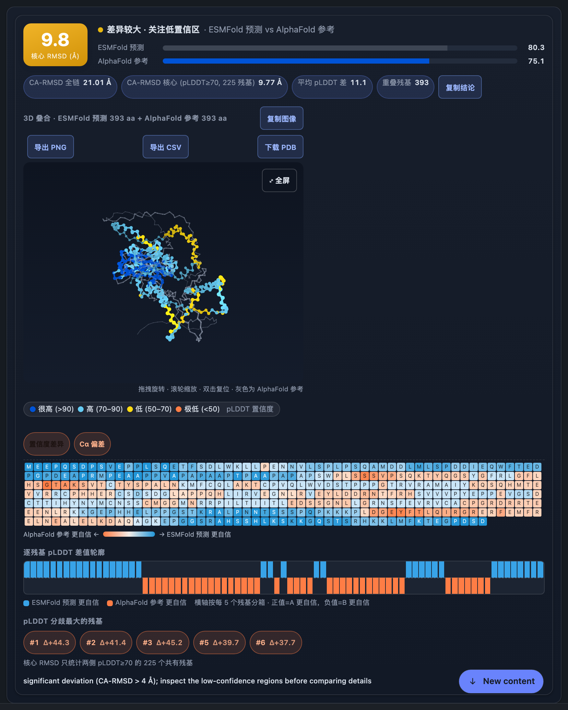 |

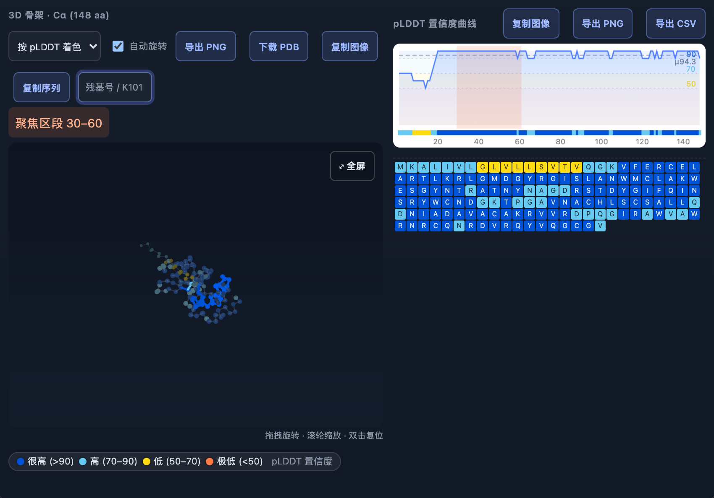

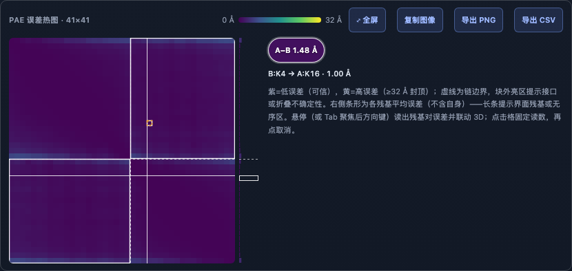

## Layout

```
package.json                     @aghes/protein-view manifest (client descriptor)
index.mjs                        re-exports the in-process runtime
extensions/main/
  index.mjs                      runtime side (service defs, permissions)
  agnes.client.json              client descriptor: entry, styles, slots, services
  client/index.js                THE client bundle (single file, plain ESM + h())
  client/index.css               panel styles
```

`client/index.js` is a hand-maintained bundle (no build step). Everything the
browser runs lives there: components written with `h(tag, props, children)`,
canvas renderers (3D projection, curve, PAE heatmap), export/clipboard helpers,
and the slot registration in `apply(ctx)`.

## How panels attach

`apply(ctx)` registers one slot component per tool key (`predict_structure`,
`analyze_confidence`, `compare_alphafold`, `predict_complex`, `batch_predict`,
`compare_structures`, `uniprot_search`) under the `tool.call.toolview` slot.
The slot re-asserts itself on declaration events because transcript remounts
collapse child records (see the comment in `apply`). Panels parse the tool's
`resultPreview` JSON and fetch structure data through the allowed services:

- `protein.structure` — parsed PDB: residues, ligand atoms/bonds
- `protein.pae` — PAE matrix npz (base64 bytes)
- `protein.report` — auxiliary report data
- `protein.file` — raw PDB relay for the「下载 PDB」button (read-only,
  extension-allowlisted, ≤700 KB so the result fits the 1 MiB budget)

Adding a toolview for a new tool = add the key to `KEYS` and branch on
`owner.toolName` inside `ProteinToolView`.

## Development loop

Tests live in `../dev-tests` (shared with protein-predictor):

1. **Offline suites** (`run-all.sh`, no daemon): mount components under
   happy-dom with stubbed services and a recording 2d-context. Before running,
   refresh the snapshot the suites import:
   `cp ../protein-view/extensions/main/client/index.js /tmp/pv-client-test/index.js`
   (a stale snapshot produces baffling failures — this has bitten repeatedly).
2. **Republish** after any client change:
   `node --import tsx agh-update-view.mts` (cwd `dev-tests`).
3. **Live probes** (`run-all.sh --live`, ~10 min): drive the real Web UI at
   `127.0.0.1:4177` via chrome-headless-shell. The sidebar renders only the
   latest ~100 session titles, so probes match sessions by content candidates
   rather than fixed titles.

Gotchas live in `~/.claude/projects/-Users-wanghanbao/memory/agh-web-ui-live-probes.md`
(happy-dom event quirks, headless clipboard denial, α-blend pixel thresholds).

## Responsive behavior

The panel renders inside the host chat column, so breakpoints respond to the
**panel's own width**, not the viewport: `.pv-root` is a CSS container
(`container-type: inline-size`) and `.pv-grid` stacks to a single column under
`@container pvpanel (max-width: 760px)` (a viewport media query remains as a
fallback). Legend items (`.pv-legend-item`, `.pv-chain-chip`, `.pv-plddt-el`,
`.pv-legend-note`) are `white-space: nowrap` so labels wrap as whole units —
the chip itself is `flex-wrap: wrap`, so phone-width panels (~300px) re-flow
the legend into multiple rows instead of overflowing. Long tool titles in the
3D toolbar (e.g. `3D 叠合 · ESMFold 预测 393 aa + AlphaFold 参考 393 aa`) also
gain `white-space: normal` under the same container query. Verified down to a
340px viewport with zero horizontal overflow across main / batch / compare.
Two known-benign behaviors: host styles leak `select { width: 100% }`, capped
by `.pv-toolbar-controls .pv-select`; toolbars flex-wrap buttons at narrow
widths.

## Dark theme

The host applies a `.dark` class on `<html>` (system/light/dark setting). The
panel's colors are token-driven (`--pv-text/--pv-muted/--pv-line/--pv-border`
on `.pv-root`), and a `.dark .pv-root` override block at the end of
`index.css` redefines those tokens plus the handful of hardcoded light
surfaces (cards, tracks, brand-blue links/buttons, warm accent text). Canvas
figures (confidence curve, PAE heatmap, 3D view) keep their own painted
backgrounds on purpose: they read as paper-figure cards and exports stay
byte-identical between themes. Light mode is untouched — the override block
only matches under `.dark`. Verified live in both directions (computed
surfaces flip and restore, screenshots reviewed).

## Conventions

- Flat output schemas only (nested objects are rejected by the protocol);
  complex payloads are normalized client-side (e.g. ligand atoms/bonds).
- Every export figure is self-explanatory: composites embed the active
  color-scale legend (see `build3DComposite` / `buildCurveComposite` /
  `buildPaeComposite` / `buildCompareComposite`); export and clipboard copy
  share one code path per panel.
- The compare panel's ΔpLDDT scale is direction-aware: blue = the first model
  (prediction / `pairwise.labels[0]`) more confident, orange = the second model
  (reference) more confident, saturation = |ΔpLDDT| (0 → ≥30). `deltaColor`,
  the in-panel strip legend, the ΔpLDDT sparkline legend, and the exported
  composite legend all share these semantics — keep them in sync.
- New services must be added to `services` in `agnes.client.json` (allowlist).
